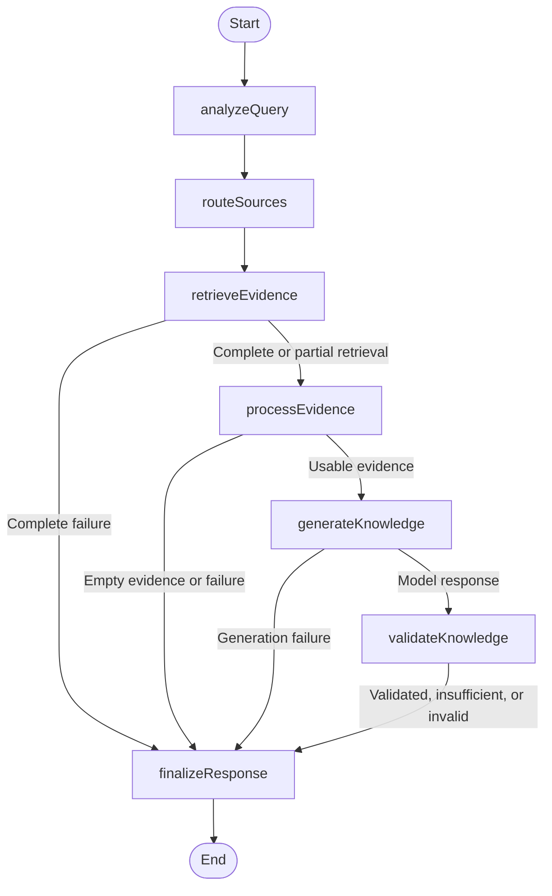

# AI Personal Knowledge Assistant

Search for a topic, read an AI-generated explanation with source links, and
follow related concepts in an interactive graph. Expand a concept to add new
branches to the current workspace.

## Stack

- Next.js 16 App Router, React 19, strict TypeScript, and Tailwind CSS 4
- shadcn/ui with Base UI and the Nova preset, plus Lucide React icons
- Cytoscape.js for rendering the graph, with React state as its source of truth
- LangGraph.js and LangChain Core for orchestration, the Google Gemini SDK for
  generation, external retrieval providers for sources, and Zod for validation
- Vitest, jsdom, React Testing Library, jest-dom, MSW, Playwright Test, and
  axe-core for automated checks, plus Playwright MCP for interactive inspection
- ESLint and Prettier for code quality, Git and GitHub for version control, and
  Vercel for eventual deployment

## Getting started

Use [Node.js 26 LTS](https://github.com/nodejs/Release#release-schedule),
pnpm 12.23.0 (pinned in `package.json`), and Git.

```sh
pnpm install --frozen-lockfile
pnpm exec playwright install chromium
pnpm dev
```

The dashboard is available at [localhost:3000](http://localhost:3000).
On Linux CI, use `pnpm exec playwright install --with-deps chromium` when
Chromium's system dependencies also need to be installed.

## Checks and scripts

| Command             | Purpose                                                        |
| ------------------- | -------------------------------------------------------------- |
| `pnpm peers check`  | Check the resolved dependency peer ranges.                     |
| `pnpm typecheck`    | Generate Next.js route types and run strict TypeScript checks. |
| `pnpm lint`         | Apply the Next.js ESLint rules.                                |
| `pnpm format`       | Format supported project files with Prettier.                  |
| `pnpm format:check` | Check formatting.                                              |
| `pnpm test`         | Run Vitest unit and component tests once.                      |
| `pnpm test:watch`   | Watch for changes with Vitest.                                 |
| `pnpm test:e2e`     | Test the dashboard in Chromium.                                |
| `pnpm build`        | Create a production build.                                     |
| `pnpm start`        | Serve the production build on port 3000.                       |

Playwright Test starts the local development server when needed and retains a
screenshot and trace on failure. The HTML report is written to `playwright-report/`.
Playwright MCP provides a separate browser for interactive inspection.

## Environment variables

Use `.env.example` as the template for a local `.env.local` file. The labeled
example graph and mocked tests run without credentials.

| Variable            | Use                                                                    |
| ------------------- | ---------------------------------------------------------------------- |
| `GEMINI_API_KEY`    | Required on the server for `POST /api/search` and `POST /api/related`. |
| `GEMINI_MODEL`      | Optional Gemini model override. Defaults to `gemini-3.8-flash`.        |
| `TAVILY_API_KEY`    | Required for Tavily web search and domain-restricted official docs.    |
| `WIKIPEDIA_CONTACT` | Optional public operator email or project URL sent in the User-Agent.  |

Git ignores `.env.local`. Keep keys in server-side code and omit the
`NEXT_PUBLIC_` prefix for credentials.

## Retrieval API

The server-side retrieval engine can be tested independently of the dashboard.
Send a JSON request with a query of 1 to 300 characters to the local server.

```http
POST /api/retrieve
Content-Type: application/json

{"query":"What is machine learning?"}
```

The response contains the normalized query, overall status, selected providers,
ranked results, and provider errors. Each result carries a stable URL-based ID,
source metadata, text evidence, and a retrieval timestamp.

- General knowledge queries use Wikipedia and Tavily. Recognized technology
  questions use the relevant official documentation registry and Tavily.
- Software project discovery also uses GitHub repository search. A direct
  GitHub repository identifier uses the repository metadata endpoint.
- Official documentation search restricts Tavily to the registry's domains
  and checks the returned HTTPS host and documentation path. The registry
  covers React, Next.js, TypeScript, MDN, Python, and Node.js.
- Each selected provider runs one timed request concurrently, with at most three
  requests per retrieval. The service considers up to five results per provider
  and returns up to twelve. A missing key disables both Tavily-backed providers.

Duplicate detection ignores URL fragments, trailing slashes, tracking
parameters, and query parameter order. It retains the winning provider's URL
and metadata, preferring the stronger source type and then the longer snippet.
Distinct URLs can remain even when their titles match. Ranking uses a 0–1
heuristic score based on query-term coverage (68%, with title matches weighted
more heavily), source type (22%), and bounded evidence length (10%).

HTTP `200` includes successful empty searches and partial results. Invalid JSON
or queries return `400`, oversized bodies return `413`, and other content types
return `415`. Complete failures return `502` for upstream failures, `503` for
unavailable or rate-limited retrieval, or `504` when all selected providers time out.

## Structured knowledge API

`POST /api/search` accepts the same JSON query as `/api/retrieve`. After request
validation, the server checks its Gemini configuration and invokes the compiled
LangGraph workflow. The workflow passes usable evidence to the Google GenAI
SDK (3.6.1). The default model is
[Gemini 3.8 Flash](https://aistudio.google.com/docs/models/gemini-3.8-flash).
Choose a model that supports structured JSON when setting `GEMINI_MODEL`.

- The evidence builder revalidates provider records and sends up to six sources,
  with at most 1,600 characters per excerpt and 12,000 UTF-8 bytes for the
  serialized evidence array. The versioned system instruction treats the query
  and retrieved text as untrusted data.
- Gemini gets one attempt, a 20-second deadline, and an output budget of 6,144
  tokens. The service caps decoded model text at 32 KiB, parses the JSON and
  validates it with Zod.
- A successful response includes a title, summary, detail, sections, takeaways,
  concepts, relationships, and citations. Claims distinguish evidence from
  synthesis. The service checks relationship endpoints and source IDs,
  assigns stable graph IDs, and builds citations from the supplied retrieval
  records. It retains the original canonical URLs and available source metadata.

Successful and insufficient-evidence responses use HTTP `200`. The latter
returns `status: "insufficient_evidence"` and `knowledge: null`. Successful
generation includes the model and prompt version. The response reports
retrieval status and provider errors separately from generated knowledge.

Both endpoints share request validation. Search returns fixed error codes and
messages for retrieval failure, credential errors, quotas, timeouts, and
invalid generated data. Generation is skipped when configuration is missing
or retrieval finds no usable evidence. Source validation verifies the identity
of each citation. The accuracy and interpretation of generated claims still
require review.

## Search workflow

LangGraph.js 1.7.5 runs the search pipeline on the server. The route returns the
finalized Phase 5 response with the same status codes, citations, and retrieval
metadata. The standalone retrieval endpoint executes the same provider service
directly.



- Classification and routing use the Phase 4 rules for general knowledge,
  technology, software discovery, and direct repository queries. Retrieval
  receives the selected plan and runs its existing concurrent provider calls,
  deduplication, and ranking once.
- Evidence processing revalidates and bounds ranked results using the Phase 5
  evidence builder. Generation and validation reuse the existing prompt,
  Gemini client, Zod schema, endpoint checks, and citation reconstruction.
- Zod-backed state channels hold the query, classified plan, provider metadata,
  and the payload for the current stage. Prepared evidence replaces the raw
  results, and validation clears the draft and evidence. The output channel
  returns only the finalized response. The Gemini client travels in request
  context so credentials stay outside state.
- Each request makes at most one Gemini attempt. Missing credentials are
  checked before retrieval. Expected failures and unexpected exceptions return
  fixed messages, and completed retrieval metadata is retained alongside
  generation failures. Request cancellation and the existing provider and
  model deadlines bound external work.
- Stage logs record timings, statuses, provider names, counts, and safe error
  codes. Searches stop before dispatch when LangSmith tracing or LangChain
  verbose logging is enabled in the server environment. These framework
  diagnostics can capture query and evidence payloads. Run `pnpm test` for mock-based workflow and API tests and
  `pnpm exec playwright test` for the dashboard and graph regression tests.

## Dashboard exploration

1. Submit a question or choose an example topic. The dashboard sends
   `{ "query": "JavaScript" }` to `POST /api/search` and validates the response
   before it renders the explanation, clickable sources, and initial graph.
   It selects the concept matching the query or answer title, or the first
   concept when neither matches.
2. Select a node on the canvas or under **Browse concepts** to read its
   description, see its source references, and highlight its neighbors.
3. Choose **Expand concept** to request related concepts. Each node tracks its
   own request and retry state. Successful expansion adds connected concepts
   near the selected node, updates its explanation, and keeps earlier nodes,
   relationships, positions, pan, and zoom. New concepts can be expanded too.
4. Submit a new search or choose **New exploration** to clear the current
   exploration and cancel pending requests. The workspace lives in React state
   for the current session. Cytoscape renders the graph and handles gestures.

### Expansion API

Send `POST /api/related` with `Content-Type: application/json`. The shared Zod
schemas live in `src/lib/exploration/contracts.ts`. The request is limited to
16 KiB and accepts these fields.

| Field                | Shape                                                                                                                      |
| -------------------- | -------------------------------------------------------------------------------------------------------------------------- |
| `topic`              | Original exploration query, 1–300 characters.                                                                              |
| `concept`            | Selected concept with the server-issued `id`, its `name` (up to 120 characters), and `description` (up to 400 characters). |
| `neighbors`          | Up to eight known concepts with their `id` and `name`, including the discovery parent when available.                      |
| `existingConceptIds` | Up to 100 distinct known concept IDs, including the selected concept and neighbors.                                        |

Expansion builds a focused retrieval query from the selected concept and its
context, then runs the same LangGraph pipeline, evidence builder, and Gemini
client as search. The expansion prompt receives the original topic, selected
concept, and neighbors as structured, untrusted context. It asks for an
evidence-backed explanation and up to seven additional concepts linked to the
selected anchor. The backend validates citations, drops duplicate and invalid
relationships, and returns only new concepts reachable from the anchor.
Concept IDs come from normalized names and relationship IDs from the type and
endpoints. The workspace caps the merged graph at 100 concepts.

A successful response uses the search envelope
`{ status, query, knowledge, generation, evidenceCount, retrieval }` plus
`conceptId`. Here `query` is the original exploration topic. The `knowledge`
object contains `evidenceStatus`, `evidenceNote`, `explanation`, `concepts`,
`relationships`, and `sources`. Relationship endpoints can reference existing
concepts or concepts in the returned batch. An empty batch has empty concept and
relationship arrays. Insufficient evidence returns HTTP 200 with
`status: "insufficient_evidence"`, `knowledge: null`, and a message.

Invalid fields or JSON return 400, oversized bodies return 413, and invalid
content types return 415. Retrieval and Gemini failures return the same safe
`{ error: { code, message }, retrieval? }` envelope as search. The browser
validates both endpoints' responses, times requests out after 32 seconds, and
offers retry for failed expansions. The retrieval-only API runs independently.

### Exploration tests

Run `pnpm test` for MSW-backed provider and dashboard tests, including expansion
context, validation, citations, deduplication, retry, and cancellation. Run
`pnpm exec playwright test` for the mocked JavaScript → React → Hooks journey,
viewport preservation, mobile overflow, and error recovery in Chromium.

## Status and planned phases

Phase 7 connects the dashboard to structured search and recursive concept
expansion. Automated tests mock provider and dashboard API responses.

The proposed ten-phase roadmap is:

1. Audit and stabilize the project foundation.
2. Set up the application shell and topic search UI.
3. Render, navigate, and select concepts with Cytoscape.js.
4. Retrieve, normalize, deduplicate, and rank evidence from multiple sources.
5. Generate topic explanations and related concepts with Gemini.
6. Orchestrate server-side search with LangGraph.js.
7. Connect the dashboard to structured search, citations, and recursive expansion.
8. Save and restore recent explorations locally.
9. Improve accessibility, error handling, and feature test coverage.
10. Verify production readiness and deploy to Vercel.
